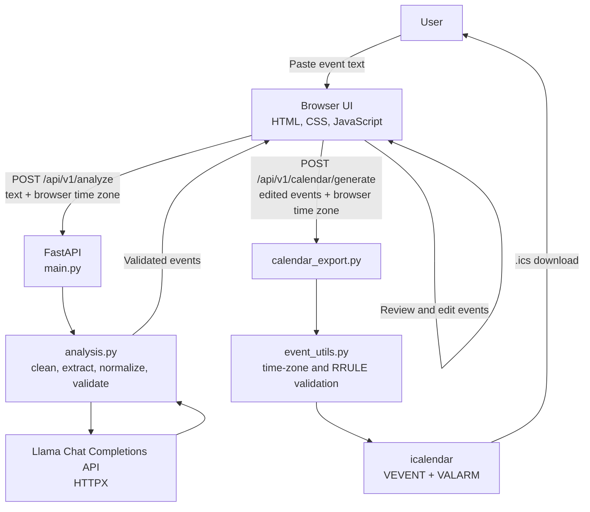

# Text to .ICS

An app that extracts events from pasted text, lets you review and edit them and downloads an `.ics` file.

## Features

- Extract multiple events from plain text, emails, tab separated schedules and Zoom invitations.
Use a Llama Chat Completions API for free form text; parse supported schedules and Zoom invitations locally.
- Extract event titles, dates and inclusive date ranges, times, locations, descriptions, time zones, recurrence rules, durations and explicitly requested reminders.
- Handle annual recurring date ranges, deadlines, event specific and message wide reminders and reminder only text without creating empty events.
- Review and edit event details, choose recurrence presets or enter custom RFC 5545 RRULEs and add preset or custom reminders.
- Calculate end times from explicit durations while preserving manually entered end times and dates.
- Preview events and download an .ics calendar containing time zones, multi day ranges, recurrence rules, locations, descriptions and VALARM reminders.
- Validate event data, including RRULEs and daylight saving time ambiguities; return extraction evidence and review notes through the analysis API.

## Tech stack

| System component | Technology |
| --- | --- |
| Runtime | Python 3.12 |
| API | FastAPI, Uvicorn |
| Validation | Pydantic 2 |
| LLM requests | HTTPX, Ollama |
| Date and time | `datetime`, `zoneinfo`, `re` |
| Frontend | HTML, JavaScript, CSS |
| Container | Docker, `python:3.12-slim` |

## Architecture



### Request flow

1. `main.py` serves `index.html` at `/` and exposes `/api/v1/health`.
2. The browser sends the pasted text and its detected IANA time zone to `POST /api/v1/analyze`.
3. `analysis.py` cleans HTML-like pasted content and selects a deterministic parser for recognized TSV schedules or supported Zoom invitations. Otherwise, it sends a JSON-constrained extraction request to `LLAMA_API_URL` using `LLAMA_MODEL`.
4. The analysis pipeline normalizes model fields, applies deterministic date-range, deadline, duration and reminder handling, validates the event models, deduplicates equivalent reminders and returns events with evidence and review notes.
5. The browser renders editable event cards and a preview. Event time zones can be selected independently; the browser time zone is the initial fallback.
6. On download, the browser sends the edited event list to `POST /api/v1/calendar/generate`.
7. `calendar_export.py` and `event_utils.py` validate and serialize the events into an `.ics` attachment. The browser downloads it as `events.ics`.

### Project files

- `main.py` - FastAPI app, HTML page route and health route.
- `analysis.py` - analyze endpoint, LLM request, extraction orchestration, normalization and event validation.
- `event_utils.py` - text cleanup, structured/Zoom parsers, date/time/time-zone helpers, duration calculation, reminder extraction and RRULE validation.
- `calendar_export.py` - calendar endpoint and `VEVENT`/`VALARM` generation.
- `models.py` - Pydantic request and event data models.
- `index.html` - complete browser interface and client-side preview/edit/download behavior.
- `requirements.txt` - Python dependencies.
- `Dockerfile` - single container build and Uvicorn launch.

## Run locally

Requires Python 3.12+ and Ollama.

```bash
python3 -m venv .venv
source .venv/bin/activate
pip install -r requirements.txt
ollama pull llama3
```
Start Ollama in one terminal:
ollama serve

Start the app in another terminal:
```bash
uvicorn main:app --reload
```

## Run with Docker

```bash
docker build -t text-to-ics .
docker run --rm -p 8000:8000 \
  -e LLAMA_API_URL=http://host.docker.internal:11434/v1/chat/completions \
  -e LLAMA_MODEL=llama3 \
  text-to-ics
```

Ollama must be reachable from the container. On Docker Desktop, use `host.docker.internal` to reach a service on the host.

## API endpoints

- `GET /` - serves the web interface.
- `GET /api/v1/health` - returns `{ "ok": true }`.
- `POST /api/v1/analyze` - accepts text and a time zone; returns extracted events, evidence, review notes and time-zone metadata.
- `POST /api/v1/calendar/generate` - accepts events and a time zone; returns an `.ics` file.
- `GET /docs` - FastAPI interactive API documentation.
