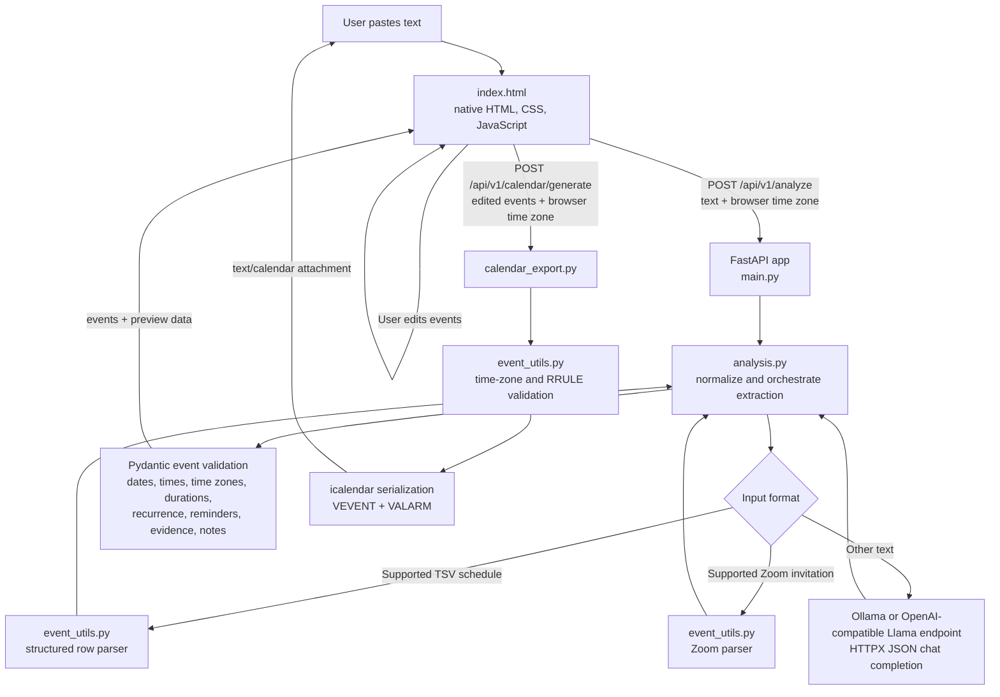

# Text to .ICS

A small web app that extracts events from pasted text, lets you review and edit them, and downloads an iCalendar (`.ics`) file.

## Features

- Paste plain text, email text, or tab-separated schedule rows; analyze the text into up to 200 events.
- Use the configured Llama chat-completions API for general text extraction. The default is Ollama at `http://localhost:11434/v1/chat/completions` with model `llama3`.
- Parse supported tab-separated schedules and Zoom invitations deterministically, without an LLM request.
- Extract event titles, dates, inclusive end dates, start/end times, locations, descriptions, time zones, recurrence rules, and explicitly requested reminders where present in the source.
- Handle date ranges, repeated annual date ranges, explicit event durations, deadlines, scoped or message-wide reminder requests, and multi-event input.
- Ignore blank form fields and common pasted UI output; do not treat reminder-only text as an event. The extraction prompt also instructs the model to ignore email timestamps, signatures, disclaimers, cancelled events, and superseded text.
- Review and edit each event's title, start/end dates, start/end times, location, time zone, description, recurrence, and reminders. Add or remove events before export.
- Choose common recurrence presets or enter a custom RFC 5545 RRULE. Invalid rules are rejected before calendar generation.
- Select preset reminders or add a custom reminder in minutes, hours, days, or weeks. Duplicate intervals are removed.
- See a preview of the current event dates, times, time zones, locations, recurrence, and reminders.
- Calculate an end time from an explicitly extracted duration when the user has not manually set an end time. Editing the date, start time, or time zone recalculates that end. Explicitly entered end times and dates are preserved.
- Generate an `.ics` calendar with event time zones, inclusive multi-day date ranges, recurrence rules, locations, descriptions, and `VALARM` reminders.
- Validate dates, times, time zones, recurrence rules, durations, reminder ranges, and generated calendar serialization. Nonexistent or ambiguous local times around daylight-saving changes are rejected for review.
- Return extraction evidence quotes and review notes in the analyze API response.

Extraction depends on model output for general free-form text and can be incomplete or ambiguous. Review the extracted event details before downloading. If the LLM endpoint cannot be reached or returns invalid event data, analysis returns an error; structured schedule and supported Zoom parsing run locally.

## Technology stack

| Layer | Technology |
| --- | --- |
| Runtime | Python 3.12 (also used by the Docker image) |
| Web server and API | FastAPI, served by Uvicorn |
| Request and event validation | Pydantic 2 |
| LLM HTTP client | HTTPX, using an OpenAI-compatible chat-completions endpoint such as Ollama |
| Calendar generation | `icalendar` Python package |
| Date/time and time zones | Python standard library `datetime`, `zoneinfo`, and `re` |
| Frontend | One static HTML page with native JavaScript and CSS; no Node.js or frontend build step |
| Container | Docker, based on `python:3.12-slim` |

Dependencies and version ranges are listed in [`requirements.txt`](requirements.txt). The app does not use a database, authentication service, persistent storage, or a frontend framework.

## Architecture



### Request flow

1. `main.py` serves `index.html` at `/` and exposes `/api/v1/health`.
2. The browser sends the pasted text and its detected IANA time zone to `POST /api/v1/analyze`.
3. `analysis.py` cleans HTML-like pasted content and selects a deterministic parser for recognized TSV schedules or supported Zoom invitations. Otherwise, it sends a JSON-constrained extraction request to `LLAMA_API_URL` using `LLAMA_MODEL`.
4. The analysis pipeline normalizes model fields, applies deterministic date-range, deadline, duration, and reminder handling, validates the event models, deduplicates equivalent reminders, and returns events with evidence and review notes.
5. The browser renders editable event cards and a preview. Event time zones can be selected independently; the browser time zone is the initial fallback.
6. On download, the browser sends the edited event list to `POST /api/v1/calendar/generate`.
7. `calendar_export.py` and `event_utils.py` validate and serialize the events into an `.ics` attachment. The browser downloads it as `events.ics`.

### Source files

- `main.py` — FastAPI app, HTML page route, and health route.
- `analysis.py` — analyze endpoint, LLM request, extraction orchestration, normalization, and event validation.
- `event_utils.py` — text cleanup, structured/Zoom parsers, date/time/time-zone helpers, duration calculation, reminder extraction, and RRULE validation.
- `calendar_export.py` — calendar endpoint and `VEVENT`/`VALARM` generation.
- `models.py` — Pydantic request and event data models.
- `index.html` — complete browser interface and client-side preview/edit/download behavior.
- `requirements.txt` — Python dependencies.
- `Dockerfile` — single-container build and Uvicorn launch.

## Run locally

Requires Python 3.12+ and Ollama for LLM-based free-form extraction. Structured TSV and supported Zoom formats are parsed locally.

```bash
python3 -m venv .venv
source .venv/bin/activate
python -m pip install -r requirements.txt
ollama pull llama3
ollama serve
```

In another terminal, from the project directory:

```bash
source .venv/bin/activate
uvicorn main:app --reload
```

Open <http://127.0.0.1:8000>. The API documentation is at <http://127.0.0.1:8000/docs>.

Configure a different OpenAI-compatible endpoint or model with environment variables:

```bash
LLAMA_API_URL=http://localhost:11434/v1/chat/completions
LLAMA_MODEL=llama3
```

## Run with Docker

```bash
docker build -t text-to-ics .
docker run --rm -p 8000:8000 \
  -e LLAMA_API_URL=http://host.docker.internal:11434/v1/chat/completions \
  -e LLAMA_MODEL=llama3 \
  text-to-ics
```

The Ollama service must be reachable from the container. `host.docker.internal` is the usual host address on Docker Desktop.

## API endpoints

- `GET /api/v1/health` — liveness response.
- `POST /api/v1/analyze` — accepts `{ "text": "...", "timezone": "America/New_York" }`; returns extracted events, evidence, review notes, and the resolved time zone.
- `POST /api/v1/calendar/generate` — accepts `{ "events": [...], "timezone": "..." }`; returns an `.ics` attachment.
- `GET /docs` — FastAPI's interactive API documentation.
